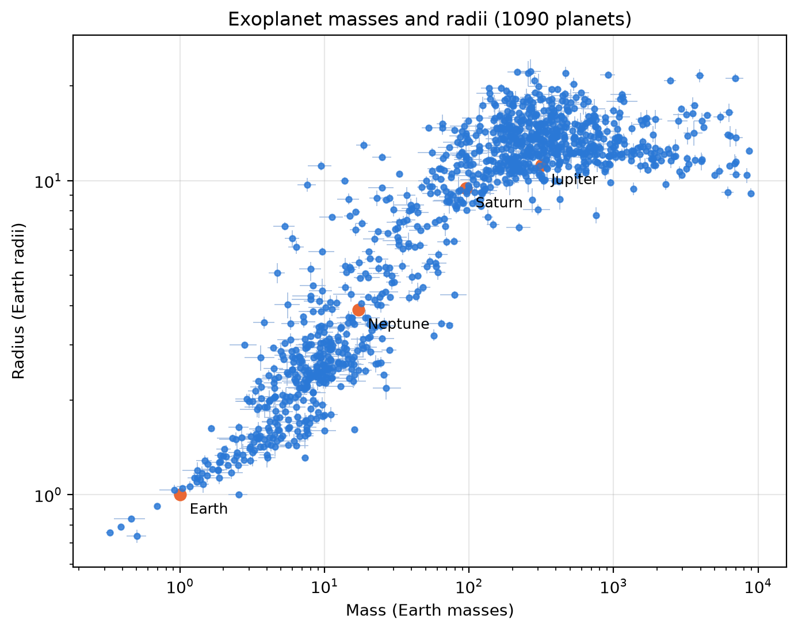
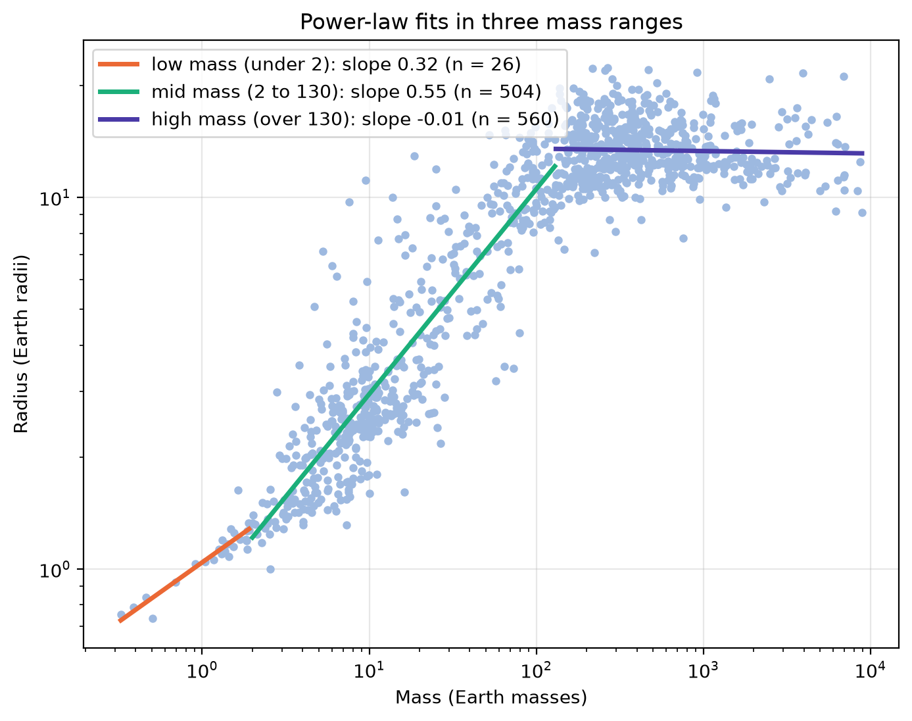
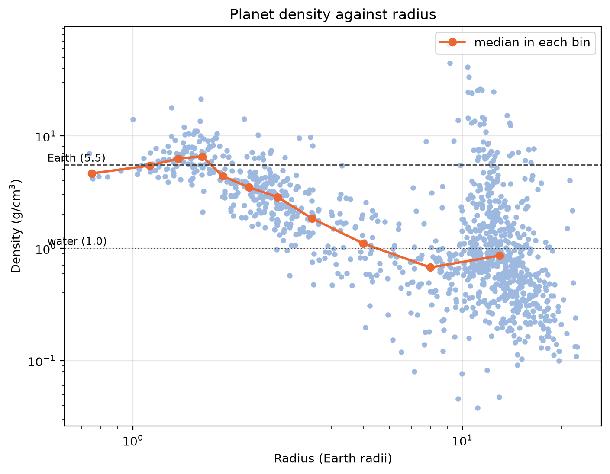

# Exoplanet mass-radius relation

This project uses real data from the NASA Exoplanet Archive to study how a planet's radius depends on its mass, and where planets change from rocky to gas-rich. Using 1,090 planets with well-measured masses and radii, I found that radius grows gently with mass for small planets, more steeply for Neptune-like planets, and levels off for giants, and that the median density drops away from Earth-like values at roughly 1.75 to 3 Earth radii.

## Question
Where does a planet stop being rocky and become gas-rich, and can I see it in real data?

## How this was built
I've been teaching myself Python alongside my A-level studies. The analysis code comes from a step-by-step guide that Claude (Anthropic's AI assistant) prepared for this project. I typed it in myself, ran it on the real NASA data, tested how sensitive the results are by changing the mass-range edges and the density threshold, and wrote up the results. Claude explained the ideas as I went.

## Data
NASA Exoplanet Archive, Planetary Systems Composite Parameters table, downloaded on 3 October 2026. It had 6,375 planets, 6,301 with both a radius and a mass.

Cuts:
1. Kept only measured masses, 2,426 planets. I removed masses estimated from the radius (that would be circular) and minimum masses (M sin i).
2. Kept planets with mass uncertainty under 25% and radius uncertainty under 10%, leaving 1,090 planets.

## Method
1. Plotted radius against mass on log-log axes.
2. Fitted a power law R = a * M^b in three mass ranges, with uncertainties from a bootstrap (5,000 resamples, 16th to 84th percentile).
3. Calculated density = 5.514 * M / R^3 (g/cm^3, Earth units) and took the median in radius bins.

## Results

Slope b with 16-84% range, for two choices of mass-range edges:

| Range (Earth masses) | Slope | n |
|---|---|---|
| Under 10 | 0.454 (0.432 to 0.478) | 249 |
| 10 to 150 | 0.585 (0.565 to 0.604) | 302 |
| Over 150 | -0.012 (-0.021 to -0.003) | 539 |
| Under 2 | 0.320 (0.295 to 0.350) | 26 |
| 2 to 130 | 0.552 (0.541 to 0.563) | 504 |
| Over 130 | -0.006 (-0.016 to 0.002) | 560 |

The first three rows are my first try (`results_first_try.csv`, `figures/fits_first_try.png`). The last three use edges near the published break points, and are the ones shown in `figures/fits.png` and `results.csv`.

Radius grows with mass roughly as M^0.3 for planets under 2 Earth masses and as M^0.55 between 2 and 130 Earth masses, and is flat (slope close to 0) above 130 Earth masses.

Moving the range edges changed the slopes by more than their bootstrap uncertainties (small planets 0.454 to 0.320, middle 0.585 to 0.552), so my choice of boundaries is the biggest source of uncertainty in these fits.

Median density is Earth-like (4.6 to 6.6 g/cm^3) up to about 1.75 Earth radii, then falls steadily to about 1 g/cm^3, the density of water, at 4 to 6 Earth radii. The first radius bin with a median below 3.5 g/cm^3 is 2.0 to 2.5 Earth radii (median 3.49), but with a threshold of 3.0 it moves to 2.5 to 3.0. The transition is better described as a range of about 1.75 to 3 Earth radii than as one exact value.

## Limitations
- Planets that are easy to detect and weigh, such as large planets around bright, quiet stars, are over-represented, and the uncertainty cuts favour them further.
- Only 26 planets lie below 2 Earth masses and only 6 below 1 Earth radius, so results there are less certain.
- The mass-range edges and the 3.5 g/cm^3 density threshold are my choices, and the results change when I move them.
- The straight-line fits treat every planet equally and ignore each planet's own error bars.
- The heaviest objects, up to about 8,900 Earth masses (around 28 Jupiter masses), may be brown dwarfs rather than planets, and they are included in the highest mass range.
- NASA's composite table can take a planet's radius and mass from different publications, so they may not be perfectly consistent.

## Run it
    pip install -r requirements.txt
    python step2_explore.py
    python step3_clean.py
    python step4_plot_mass_radius.py
    python step5_fit_power_laws.py
    python step6_density.py

The data file is included in `data/`.

## Credits
This research has made use of the NASA Exoplanet Archive, which is operated by the California Institute of Technology, under contract with the National Aeronautics and Space Administration under the Exoplanet Exploration Program.

Chen, J. and Kipping, D. (2017), ApJ 834, 17.
Rogers, L. A. (2015), ApJ 801, 41.
Fulton, B. J. et al. (2017), AJ 154, 109.